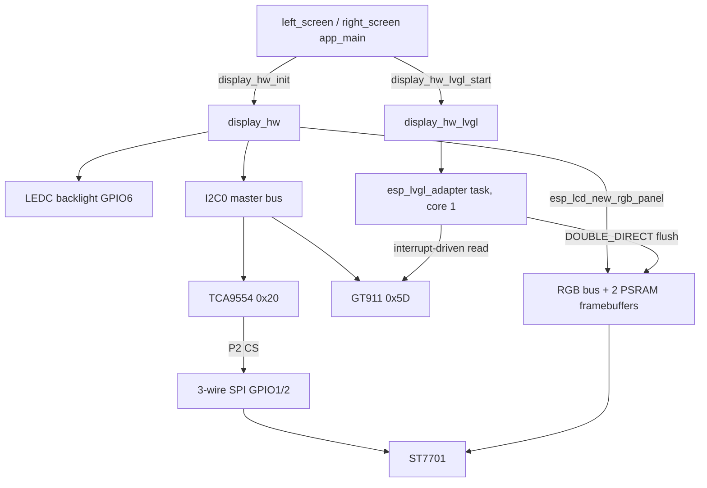
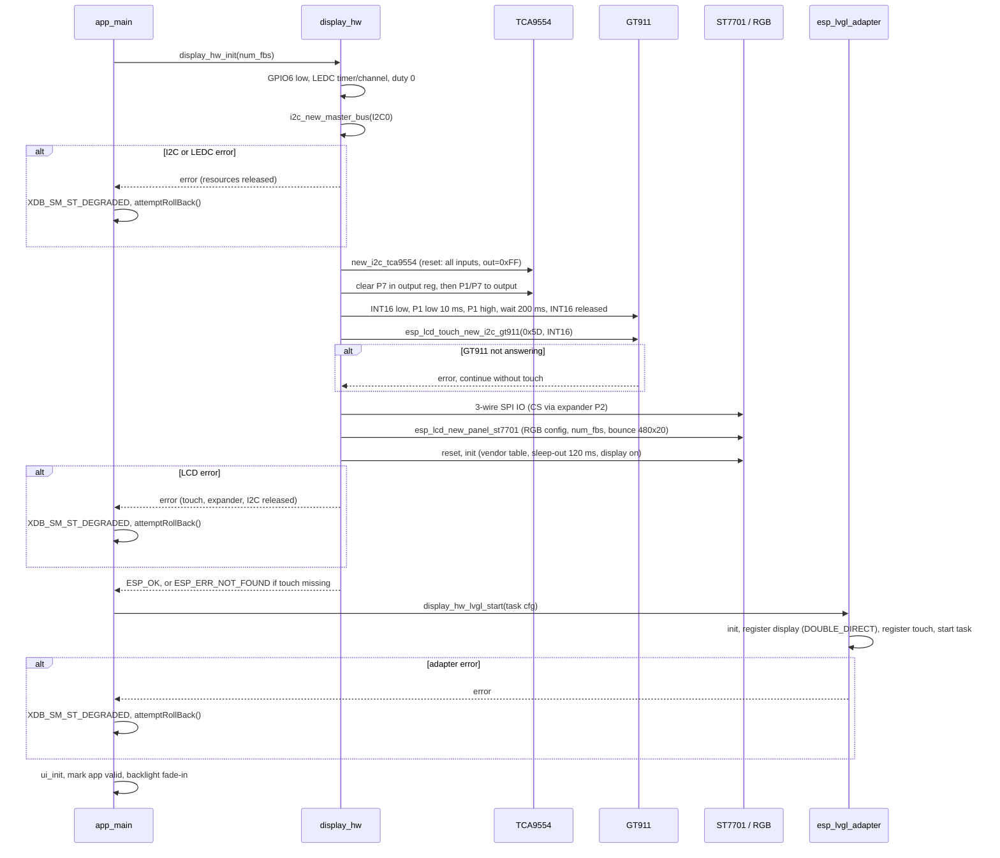

# display_hw — Theory of Operation

## 1. Responsibilities

`display_hw` owns every peripheral of the Waveshare 2.8C display board that is not the CAN transceiver: the shared I2C bus, the TCA9554 IO expander, the LEDC backlight, the GT911 touch controller and the ST7701 RGB panel. `display_hw_lvgl` sits on top and hands the panel and touch handles to `esp_lvgl_adapter`, which owns the LVGL task, tick, lock and flush pipeline.

## 2. Bring-up sequence

## 3. Design notes

- **One I2C driver.** The expander and touch use the `i2c_master` driver on one bus handle. The legacy `driver/i2c.h` driver must not be used anywhere in an app that links this component: ESP-IDF aborts at boot when both are active.
- **Buzzer pin at boot.** The TCA9554 driver resets the chip to all-inputs with output register 0xFF, and `esp_io_expander_set_level()` refuses input pins. The output register is therefore written directly to clear P7 before the pin becomes an output.
- **GT911 address.** RST is on the expander, so the GT911 driver's own GPIO reset is disabled (`rst_gpio_num = NC`). Holding INT low through reset selects address 0x5D.
- **ST7701 init table.** Copied byte for byte from the previous board definition, including COLMOD `0x66` while the RGB bus carries RGB565. The array is `static const` because the driver keeps the pointer until `esp_lcd_panel_init()`. The control IO is kept alive (`enable_io_multiplex = 0`, `mirror_by_cmd = 1`).
- **Bounce buffer.** The project runs a 64 B data cache line with 80 MHz octal PSRAM. Without RGB bounce buffers this combination can make the image drift, so `DISPLAY_HW_BOUNCE_BUFFER_LINES` defaults to 20 and a `#warning` fires if it is set to 0. `SPIRAM_XIP_FROM_PSRAM` keeps the RGB ISR running during flash writes (CAN OTA).
- **Tear mode.** `DOUBLE_DIRECT`: two full framebuffers in PSRAM (2 x 460.8 KB) and LVGL DIRECT render mode, the same layout as the previous port. The adapter's RGB default (`TRIPLE_PARTIAL`) would need a third framebuffer.
- **Thread safety.** `display_hw_backlight_set()` is a LEDC register write and safe from any task. `display_hw_buzzer_set()` goes through the I2C bus lock and can wait for an in-flight touch read.
