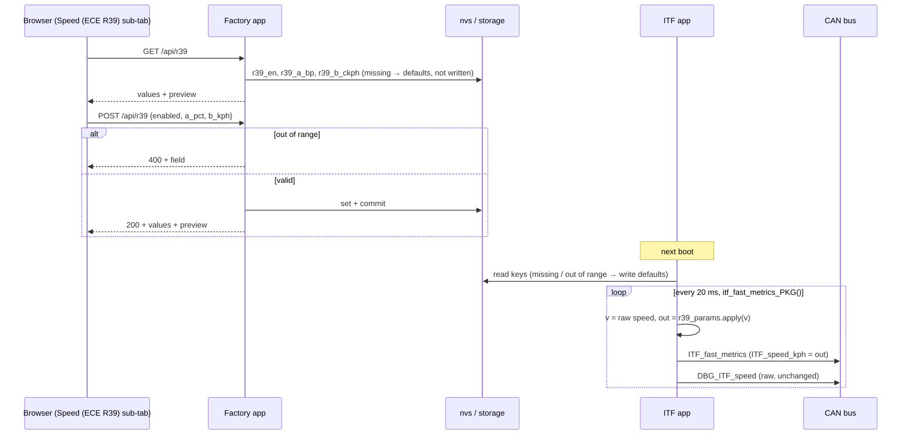
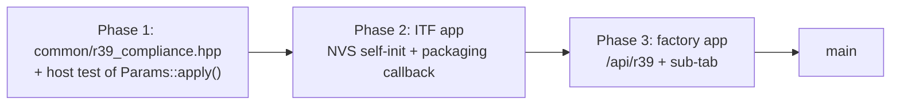

# ECE R39 Speed Compliance Mode (Plan)

Status: implemented and merged (#143), host test passes, validated on hardware 2026-11-02. The "Current state on `main`" section describes the code before this change. Decisions agreed (see [Decisions](#decisions)). Tracks issue #133. Since #149 the three keys are `en`, `a_bp` and `b_ckph` in namespace `vx_r39` (see `common/nvs_keys.hpp`); the `storage` / `r39_*` names below are the original layout.

## Objective

Add an optional compliance mode to the interface board (ITF) app so that the speed it broadcasts in `ITF_fast_metrics` meets UNECE Regulation 39: the indicated speed is never below the true speed and never above it by more than 10 % + 4 km/h. When the mode is active, the broadcast speed is `A * v + B` (with a low-speed blend to 0 km/h, see below). The mode, `A` and `B` live in NVS and are edited from the ITF factory app.

## Requirements (from the request)

| # | Requirement |
| :--- | :--- |
| R1 | When compliance mode is on, the ITF app sends `A * v + B` as `ITF_speed_kph` on the CAN bus. Debug messages (`DBG_ITF_speed`, `DBG_ITF_pulse_counts`, ...) are untouched. |
| R2 | The modifier is applied in the CAN message packaging callback (`itf_fast_metrics_PKG()` in [`twai_ops.hpp`](../interface_board/main/twai_ops.hpp)). |
| R3 | `A`, `B` and the enable flag are stored in NVS. |
| R4 | The ITF factory app can switch the mode on or off and edit `A` and `B`. |
| R5 | `A` is entered as a percentage, always positive or null: +4 % gives `A = 1.04`. |
| R6 | `B` is in km/h. |
| R7 | When enabled, a clamp and blend to 0 km/h exists for very low speeds, so `B` does not show a speed at standstill. |
| R8 | Usual NVS self-init and defaulting: a missing or out-of-range key is rewritten with its default at ITF boot. |
| R9 | Display apps (`left_screen`, `right_screen`, their factory apps) are not changed. |

## What R39 asks of the indicated speed

With `V1` the indicated speed and `V2` the true speed, R39 requires:

```
0 <= V1 - V2 <= 0.1 * V2 + 4 km/h
```

For `V1 = A * V2 + B` this holds at every speed when:

- `A >= 1` and `B >= 0` (never under-read), and
- `A <= 1.10` and `B <= 4 km/h` (never over-read beyond the allowance).

So the compliant envelope is **A in [1.00, 1.10]** (0 % to +10 %) and **B in [0, 4] km/h**. These are the hard input limits in both apps.

## Current state on `main`

- Speed is computed in `itf_fast_metrics_PKG()` as `COEFF_FREQ_TO_SPEED_KPH_M * pwm_cap_speed.frequency + COEFF_FREQ_TO_SPEED_KPH_P` and encoded with `binocan_itf_fast_metrics_itf_speed_kph_encode()`. The signal is unsigned, 0.04 km/h per bit, range 0 to 400 km/h (binocan v0.3.0 DBC). A negative value would wrap, so the output must be clamped.
- The speed frequency drops to exactly 0 Hz after `CONFIG_PWM_DETECT_TIMEOUT` (1000 ms) without a pulse. The lowest non-zero speed the ITF can report is therefore about 1 Hz, i.e. 0.245 km/h. Raw speed is either 0 or above that.
- The gear estimator (`mcpwm_processor.hpp`) and the odometer (`itf_odometer_PKG()`) use the raw frequency and pulse count. They stay on raw values.
- `sendAnimation()` / `sendFastMetrics()` push a synthetic 0 to 270 km/h sweep at boot. It is not a measured speed and stays unmodified.
- ITF settings follow one pattern in `app_main()`: open `storage` in the default `nvs` partition, `nvs_get_*`, on `ESP_ERR_NVS_NOT_FOUND` write the default and commit, keep the value in a global from [`global_vars.hpp`](../interface_board/main/global_vars.hpp). The factory app reads the same keys (`/calibration`, `/api/settings`) and the gear estimator has its own sub-tab and `/api/gear*` endpoints in [`gear_params_web.hpp`](../factory%20apps/ITF%20factory%20app/main/gear_params_web.hpp).
- Both apps already include [`common/`](../common) (`INCLUDE_DIRS "../../common"` and `"../../../common"`), which is where the shared definitions go.

## Proposal: clamp and blend to 0 km/h

Plain `A * v + B` shows `B` km/h at standstill. The proposal fades `B` in over a low-speed band with a smoothstep weight, then clamps.

```
s(v) = clamp(v / V_BLEND, 0, 1)
w(v) = s^2 * (3 - 2 s)                   // smoothstep, 0 at v = 0, 1 at v >= V_BLEND
y(v) = A * v + B * w(v)                  // compliant output before clamping
out  = clamp(y, 0, SPEED_MAX_KPH)        // 0 .. 400 km/h, the signal range
out  = 0 if v is not finite or v <= 0
```

Why this shape:

- **Exactly 0 at standstill.** `y(0) = 0`, so a stopped car reads 0 km/h, and the 0 Hz timeout path stays 0.
- **Still compliant inside the band.** With `A >= 1`, `B >= 0` and `0 <= w <= 1`, `y - v = (A - 1) v + B w` is never negative and never larger than `(A - 1) v + B`, which already sits inside the R39 envelope. The blend never makes the reading less legal.
- **Continuous and monotonic.** `w` is non-decreasing, so `y` only rises with `v`. No step when crossing `V_BLEND`, and the slope matches `A` at both ends of the band (C1), so a needle does not jerk.
- **Does not amplify low-speed noise.** Near 0 the slope is `A`, not `A + B / V_BLEND` as a linear ramp would give. Peak slope in the middle of the band is `A + 1.5 B / V_BLEND` (1.34 with the defaults).
- **Far from the test points.** R39 checks at 40, 80 and 120 km/h (or 80 % of top speed). Above `V_BLEND` the output is exactly `A * v + B`.

`V_BLEND`: **10 km/h**, a Kconfig option (`CONFIG_R39_BLEND_END_KPH`, default 10, range 1 to 30). There is no NVS key for it.

Example with the defaults `A = 1.04` (+4 %), `B = 2.0` km/h, `V_BLEND = 10` km/h:

| True speed (km/h) | Plain `A v + B` | Blended output | Over-read | R39 allowance |
| ---: | ---: | ---: | ---: | ---: |
| 0 | 2.00 | **0.00** | 0.00 | 4.0 |
| 0.25 | 2.26 | 0.26 | 0.01 | 4.0 |
| 2 | 4.08 | 2.29 | 0.29 | 4.2 |
| 5 | 7.20 | 6.20 | 1.20 | 4.5 |
| 10 | 12.40 | 12.40 | 2.40 | 5.0 |
| 40 | 43.60 | 43.60 | 3.60 | 8.0 |
| 80 | 85.20 | 85.20 | 5.20 | 12.0 |
| 120 | 126.80 | 126.80 | 6.80 | 16.0 |

A simpler alternative is a linear ramp `w = s`, which equals `y = v (A + B / V_BLEND)` below the band. It is also compliant and continuous but has a slope break at `V_BLEND` and the higher slope right at 0. Smoothstep costs three multiplications more per 20 ms frame; it is the recommendation.

## Storage (NVS)

Default `nvs` partition, namespace `storage`, next to `fuel_full_r` and friends. Integers, like the existing calibration keys, so no float is stored and the factory form maps directly to the stored value.

| Key | Type | Meaning | Range | Default |
| :--- | :--- | :--- | :--- | :--- |
| `r39_en` | u8 | Compliance mode on (1) or off (0) | 0..1 | 0 (off) |
| `r39_a_bp` | u16 | Percentage added by `A`, in basis points (0.01 %). `A = 1 + r39_a_bp / 10000` | 0..1000 (0 % to 10.00 %) | 400 (+4 %) |
| `r39_b_ckph` | i16 | `B` in 0.01 km/h | 0..400 (0 to 4.00 km/h) | 200 (2.00 km/h) |

- `r39_b_ckph` is signed so a wider range could be opened later without a new key; negatives are rejected.
- Off by default, so updating the ITF firmware does not change what the displays show until the mode is switched on.

## Shared definitions: `common/r39_compliance.hpp`

One header-only C++ file, included by both apps (both `main` components are C++ already), so defaults, limits, key names and the transform cannot drift. Everything sits in `namespace r39`:

- `constexpr` NVS key names (`KEY_EN`, `KEY_A_BP`, `KEY_B_CKPH`), defaults (`DEFAULT_EN = false`, `DEFAULT_A_BP = 400`, `DEFAULT_B_CKPH = 200`), limits (`A_BP_MAX = 1000`, `B_CKPH_MAX = 400`) and `SPEED_MAX_KPH = 400.0f`.
- `struct Params { bool enabled; float a; float b_kph; float blend_end_kph; float apply(float v_kph) const; };` with `apply()` implementing the formula above (`std::clamp`, `std::isfinite`); when `!enabled` it returns the raw speed, clamped to 0..400 and finite.
- `struct RawParams { uint8_t en; uint16_t a_bp; int16_t b_ckph; };` with `constexpr bool in_range() const` and `Params to_params(float blend_end_kph) const`.
- `constexpr RawParams defaults()`.

No ESP-IDF include, so it compiles with the host `g++` for a unit test (see [Verification](#verification)).

## ITF app changes (`interface_board`)

1. **Globals** in [`global_vars.hpp`](../interface_board/main/global_vars.hpp): `r39::Params r39_params` initialised from `r39::defaults()` (mode off). Written once in `app_main()` before `twai_ops_init()` starts the packaging tasks, read-only afterwards, so no lock is needed.
2. **NVS self-init** in `app_main()`, inside the existing `storage` block after `overtemp_th`, same pattern as the other keys:
   - `nvs_get_u8(r39::KEY_EN)`, `nvs_get_u16(r39::KEY_A_BP)`, `nvs_get_i16(r39::KEY_B_CKPH)` into an `r39::RawParams`.
   - `ESP_ERR_NVS_NOT_FOUND`: log a warning, write the default, commit. A failed write calls `attemptRollBack()` like the other keys.
   - Value found but out of range (`RawParams::in_range()` false, which includes `en > 1`): log a warning, rewrite the default, commit. This keeps a hand-edited or future-format value from producing a non-compliant speed.
   - Build `r39_params` with `raw.to_params(CONFIG_R39_BLEND_END_KPH)` and log `ECE R39 mode: ON, A = 1.0400 (+4.00 %), B = 2.00 km/h, blend to 10 km/h` (or `OFF`).
   - If the `storage` namespace cannot be opened at all, `r39_params` keeps its compiled defaults (mode off) and the existing degraded/rollback path applies.
3. **Packaging callback** `itf_fast_metrics_PKG()` in [`twai_ops.hpp`](../interface_board/main/twai_ops.hpp): keep `speed` as the raw value, add `float speed_out = r39_params.apply(speed);` and encode `speed_out` into `itf_speed_kph`. Extend the existing `ESP_LOGD` line with `speed_out`. Nothing else in the task changes; the gear estimator, the odometer task and every `dbg_*_PKG()` task keep the raw values.
4. **Kconfig** in [`main/Kconfig.projbuild`](../interface_board/main/Kconfig.projbuild): `CONFIG_R39_BLEND_END_KPH` (int, default 10, range 1 30) in the speed/MCPWM menu.
5. **Not touched:** the odometer and trip (`itf_odometer_PKG()`, raw pulse count), `sendFastMetrics()` and `sendAnimation()` (boot sweep), the binocan DBC, the CAN IDs and cycle times.

## ITF factory app changes

The pattern follows the gear estimator: a separate header with cJSON handlers, registered from `start_webserver()`, and a sub-tab under Setup & Calibration.

1. **REST** in a new [`main/r39_web.hpp`](../factory%20apps/ITF%20factory%20app/main) (C++, like `gear_params_web.hpp`) with `r39_web_register(server)`:

   | Method | URI | Body / reply |
   | :--- | :--- | :--- |
   | GET | `/api/r39` | `{"source":"nvs"\|"default","enabled":bool,"a_pct":4.0,"b_kph":1.0,"blend_end_kph":10,"limits":{...},"preview":[{"v":0,"out":0.0},...]}` |
   | POST | `/api/r39` | `{"enabled":bool,"a_pct":number,"b_kph":number}`; any field may be omitted (keeps the stored value). Range-checked with `RawParams::in_range()`, stored as `r39_en` / `r39_a_bp` / `r39_b_ckph`, committed. 200, 400 (out of range, message names the field) or 500 (NVS). Replies with the same body as GET. |

   - `a_pct` is the percentage the user types: stored as `lround(a_pct * 100)` basis points. The server refuses (400) a non-number, a negative value, a value above 10 and a value that is not a whole number of basis points (more than 2 decimals, checked as `fabs(a_pct * 100 - lround(a_pct * 100)) > 1e-6`).
   - `b_kph` is stored as `lround(b_kph * 100)` with the same checks against 0..4 km/h.
   - The server checks stand on their own; the page checks below only spare the user a round trip.
   - GET does not write: when a key is missing it reports the default with `"source":"default"`, and the ITF app writes it on its next boot. This keeps the factory app read-only until the user saves.
   - `preview` is computed on the device with `Params::apply()` at 0, 2, 5, 10, 20, 40, 80, 120 and 160 km/h, so the page shows exactly what the ITF will send with no JavaScript copy of the formula. `blend_end_kph` is the factory app's own `CONFIG_R39_BLEND_END_KPH` (same Kconfig symbol, mirrored in the factory app's `Kconfig.projbuild`, default 10).
   - `config.max_uri_handlers` is 28 with 22 in use today; two more fit.
2. **UI** in [`main/web/index.html`](../factory%20apps/ITF%20factory%20app/main/web/index.html): a third button in `.subtab-nav`, "Speed (ECE R39)", and a `subtab-r39` panel built from the classes already on the page (`.card`, `.card-grid`, the `.gear-actions` action bar renamed to a shared `.subtab-actions`, `<mark>` for the source badge, `<small>` for help text), so it matches the General and Gear Estimator sub-tabs:

   ```
   ( General ) ( Gear Estimator ) ( Speed (ECE R39) )
     Source: [NVS | defaults]   [Save to NVS] [Reload] [Load defaults]
     ┌ Settings ─────────────────────────┐ ┌ Preview ──────────────────────────────┐
     │ [x] Compliance mode enabled       │ │ true km/h | sent km/h | over | allowed │
     │ Speed correction [ 4.00 ] %       │ │ 0 / 0.00 / 0.00 / 4.0                 │
     │   A = 1.0400  (0 to 10 %)         │ │ ...                                   │
     │ Offset B         [ 2.00 ] km/h    │ │ (from the GET/POST reply)             │
     │   (0 to 4 km/h)                   │ └───────────────────────────────────────┘
     │ <inline error line>               │
     └───────────────────────────────────┘
     Takes effect on the next ITF app boot. "Load defaults" only fills the form.
   ```

   **Input guards** (both fields; the page refuses to send anything the server would refuse):
   - `<input type="number" inputmode="decimal" min="0" max="10" step="0.01" required>` for the percentage, `min="0" max="4" step="0.01" required` for B, so the browser spinner and native validation already stay in range.
   - A `validateR39Form()` run on every `input` event and before Save. It parses with `Number()` (not `parseFloat`, so `"4abc"` is rejected), and rejects empty, `NaN`, `±Infinity`, negative values (including `-0` typed as `-`), values above the maximum, and values with more than 2 decimals (`Math.abs(v * 100 - Math.round(v * 100)) > 1e-6`). Out of range is never silently clamped; the user sees why.
   - Each error goes to the field with `setCustomValidity()` (red outline from the stylesheet) and to the inline error line under the inputs; Save is disabled while any field is invalid.
   - The "A = 1.0400" hint and the preview are only updated from valid values; an invalid field shows "A = -".
   - The values sent are the integers the device will store: the page computes `Math.round(v * 100)` and checks it is in 0..1000 (basis points) and 0..400 (0.01 km/h) before building the JSON, then sends `a_pct` / `b_kph` as those integers divided by 100, so the page and the server agree on the stored value.
   - A server 400 is shown in the inline error line (same text as the reply), like the gear editor shows its `alert()`, and the form keeps the user's values.
3. **Live readout**: the WebSocket `mcpwm` object gains `speed_r39_kph`, computed with `Params::apply()` from the stored params (reloaded after each successful POST /api/r39, so it follows edits without a reboot), and `r39_en`. In IO & Bus Debug, the Speed tile of the "MCPWM Capture Signals" grid gets a third line under `val-speed-phys`, with the same `<small style="font-weight:600; color:var(--text);">` markup:
   - mode on: `R39: 43.6 km/h`;
   - mode off: `R39: off` in the muted colour.
   The grid stays at three columns (`repeat(3, 1fr)`) and grid items stretch to the tallest tile, so the Coolant and RPM tiles keep the same height and the row stays aligned on a phone. No new tile, no new colour.
4. **Docs**: `TOO.MD` endpoint list, `docs/REQUIREMENTS.md` (new `REQ-ITF-008` and an addition to `REQ-FAC-002`), README feature list.

## Display apps

No change. The LDB and RDB keep decoding `ITF_speed_kph` as before; they simply receive the corrected value. The binocan DBC and its version are unchanged, so no display rebuild is needed.

## Sequence



## Phases



One branch (`ece-r39-compliance-mode`), one PR, one commit per phase.

## Verification

- **Formula** (host test, a small C++ file compiled with the host `g++ -std=c++17`, or the Linux target once host tests exist): `Params::apply()` returns 0 at 0 and for NaN/negative input; returns the raw speed when disabled; is monotonic over 0..400 km/h in 0.01 steps; equals `A v + B` above `V_BLEND`; satisfies `0 <= out - v <= 0.1 v + 4` for every `A` in 0..10 % and `B` in 0..4 km/h on a grid; never exceeds 400.
- **Builds**: `idf.py build` in `interface_board` and `factory apps/ITF factory app` (ESP-IDF 5.5.5), check the factory image still fits (26 % free today).
- **Self-init** (bench): wipe NVS from the factory app, boot ITF, check the boot log reports the three keys initialised and `ECE R39 mode: OFF`; then write `r39_a_bp = 5000` by hand, reboot, check it is reset to 400.
- **Factory app**: POST `a_pct = -1`, `a_pct = 12`, `a_pct = 4.005`, `b_kph = 5`, `b_kph = "x"` → 400 and nothing stored; POST a valid set → badge "NVS", preview updated.
- **Factory page guards**: type `-1`, `11`, `4.005`, `abc`, an empty field and `4e1` in each input; Save stays disabled with the reason shown, nothing is sent (check the browser network tab). Check the new sub-tab and the Speed tile on a desktop width and on a phone width next to the other tabs.
- **CAN** (bench, emulator console driving speed): mode off → `ITF_speed_kph` equals raw speed. Mode on, +4 %, 2 km/h → 0 at standstill, about 6.2 at 5 km/h, 43.6 at 40 km/h; the IO & Bus Debug readout shows the same values; `DBG_ITF_speed` frequency unchanged; gear estimate, odometer and trip unchanged.
- **Displays**: unchanged binaries show the corrected speed.

## Decisions

Agreed on 2026-11-02:

1. **B range:** 0 to 4 km/h. Negative B is refused.
2. **A range:** 0 to 10 %, hard cap in both apps.
3. **Defaults:** mode off, +4 % (`r39_a_bp = 400`), 2 km/h (`r39_b_ckph = 200`).
4. **Blend band:** smoothstep up to 10 km/h, set by `CONFIG_R39_BLEND_END_KPH`. No fourth NVS key.
5. **Odometer and trip:** stay on raw distance.
6. **Language:** new shared code is C++ in `.hpp` headers (`common/r39_compliance.hpp`, `r39_web.hpp`), not C `.h`.
7. **Live readout:** in, as a third line of the existing Speed tile.
