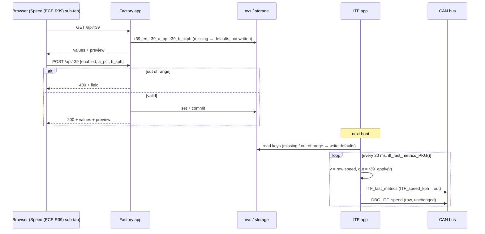
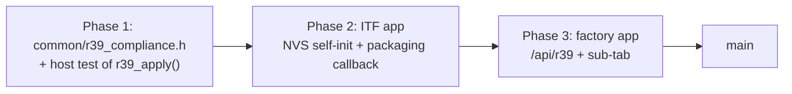

# ECE R39 Speed Compliance Mode (Plan)

Status: plan only, nothing implemented. Tracks issue #133.

## Objective

Add an optional compliance mode to the interface board (ITF) app so that the speed it broadcasts in `ITF_fast_metrics` meets UNECE Regulation 39: the indicated speed is never below the true speed and never above it by more than 10 % + 4 km/h. When the mode is active, the broadcast speed is `A * v + B` (with a low-speed blend to 0 km/h, see below). The mode, `A` and `B` live in NVS and are edited from the ITF factory app.

## Requirements (from the request)

| # | Requirement |
| :--- | :--- |
| R1 | When compliance mode is on, the ITF app sends `A * v + B` as `ITF_speed_kph` on the CAN bus. Debug messages (`DBG_ITF_speed`, `DBG_ITF_pulse_counts`, ...) are untouched. |
| R2 | The modifier is applied in the CAN message packaging callback (`itf_fast_metrics_PKG()` in [`twai_ops.hpp`](../interface_board/main/twai_ops.hpp)). |
| R3 | `A`, `B` and the enable flag are stored in NVS. |
| R4 | The ITF factory app can switch the mode on or off and edit `A` and `B`. |
| R5 | `A` is entered as a percentage, always positive or null: +4 % gives `A = 1.04`. |
| R6 | `B` is in km/h. |
| R7 | When enabled, a clamp and blend to 0 km/h exists for very low speeds, so `B` does not show a speed at standstill. |
| R8 | Usual NVS self-init and defaulting: a missing or out-of-range key is rewritten with its default at ITF boot. |
| R9 | Display apps (`left_screen`, `right_screen`, their factory apps) are not changed. |

## What R39 asks of the indicated speed

With `V1` the indicated speed and `V2` the true speed, R39 requires:

```
0 <= V1 - V2 <= 0.1 * V2 + 4 km/h
```

For `V1 = A * V2 + B` this holds at every speed when:

- `A >= 1` and `B >= 0` (never under-read), and
- `A <= 1.10` and `B <= 4 km/h` (never over-read beyond the allowance).

So the compliant envelope is **A in [1.00, 1.10]** (0 % to +10 %) and **B in [0, 4] km/h**. These become the input limits in both apps (see [Decision points](#decision-points) for a wider "expert" range).

## Current state on `main`

- Speed is computed in `itf_fast_metrics_PKG()` as `COEFF_FREQ_TO_SPEED_KPH_M * pwm_cap_speed.frequency + COEFF_FREQ_TO_SPEED_KPH_P` and encoded with `binocan_itf_fast_metrics_itf_speed_kph_encode()`. The signal is unsigned, 0.04 km/h per bit, range 0 to 400 km/h (binocan v0.3.0 DBC). A negative value would wrap, so the output must be clamped.
- The speed frequency drops to exactly 0 Hz after `CONFIG_PWM_DETECT_TIMEOUT` (1000 ms) without a pulse. The lowest non-zero speed the ITF can report is therefore about 1 Hz, i.e. 0.245 km/h. Raw speed is either 0 or above that.
- The gear estimator (`mcpwm_processor.hpp`) and the odometer (`itf_odometer_PKG()`) use the raw frequency and pulse count. They stay on raw values.
- `sendAnimation()` / `sendFastMetrics()` push a synthetic 0 to 270 km/h sweep at boot. It is not a measured speed and stays unmodified.
- ITF settings follow one pattern in `app_main()`: open `storage` in the default `nvs` partition, `nvs_get_*`, on `ESP_ERR_NVS_NOT_FOUND` write the default and commit, keep the value in a global from [`global_vars.hpp`](../interface_board/main/global_vars.hpp). The factory app reads the same keys (`/calibration`, `/api/settings`) and the gear estimator has its own sub-tab and `/api/gear*` endpoints in [`gear_params_web.hpp`](../factory%20apps/ITF%20factory%20app/main/gear_params_web.hpp).
- Both apps already include [`common/`](../common) (`INCLUDE_DIRS "../../common"` and `"../../../common"`), which is where the shared definitions go.

## Proposal: clamp and blend to 0 km/h

Plain `A * v + B` shows `B` km/h at standstill. The proposal fades `B` in over a low-speed band with a smoothstep weight, then clamps.

```
s(v) = clamp(v / V_BLEND, 0, 1)
w(v) = s^2 * (3 - 2 s)                   // smoothstep, 0 at v = 0, 1 at v >= V_BLEND
y(v) = A * v + B * w(v)                  // compliant output before clamping
out  = clamp(y, 0, SPEED_MAX_KPH)        // 0 .. 400 km/h, the signal range
out  = 0 if v is not finite or v <= 0
```

Why this shape:

- **Exactly 0 at standstill.** `y(0) = 0`, so a stopped car reads 0 km/h, and the 0 Hz timeout path stays 0.
- **Still compliant inside the band.** With `A >= 1`, `B >= 0` and `0 <= w <= 1`, `y - v = (A - 1) v + B w` is never negative and never larger than `(A - 1) v + B`, which already sits inside the R39 envelope. The blend never makes the reading less legal.
- **Continuous and monotonic.** `w` is non-decreasing, so `y` only rises with `v`. No step when crossing `V_BLEND`, and the slope matches `A` at both ends of the band (C1), so a needle does not jerk.
- **Does not amplify low-speed noise.** Near 0 the slope is `A`, not `A + B / V_BLEND` as a linear ramp would give. Peak slope in the middle of the band is `A + 1.5 B / V_BLEND` (1.19 with the defaults).
- **Far from the test points.** R39 checks at 40, 80 and 120 km/h (or 80 % of top speed). Above `V_BLEND` the output is exactly `A * v + B`.

`V_BLEND` default: **10 km/h**. It is a Kconfig option (`CONFIG_R39_BLEND_END_KPH`, range 1 to 30) rather than an NVS key, to keep the factory UI to the three values asked for.

Example with `A = 1.04` (+4 %), `B = 1.0` km/h, `V_BLEND = 10` km/h:

| True speed (km/h) | Plain `A v + B` | Blended output | Over-read | R39 allowance |
| ---: | ---: | ---: | ---: | ---: |
| 0 | 1.00 | **0.00** | 0.00 | 4.0 |
| 0.25 | 1.26 | 0.26 | 0.01 | 4.0 |
| 2 | 3.08 | 2.18 | 0.18 | 4.2 |
| 5 | 6.20 | 5.70 | 0.70 | 4.5 |
| 10 | 11.40 | 11.40 | 1.40 | 5.0 |
| 40 | 42.60 | 42.60 | 2.60 | 8.0 |
| 80 | 84.20 | 84.20 | 4.20 | 12.0 |
| 120 | 125.80 | 125.80 | 5.80 | 16.0 |

A simpler alternative is a linear ramp `w = s`, which equals `y = v (A + B / V_BLEND)` below the band. It is also compliant and continuous but has a slope break at `V_BLEND` and the higher slope right at 0. Smoothstep costs three multiplications more per 20 ms frame; it is the recommendation.

## Storage (NVS)

Default `nvs` partition, namespace `storage`, next to `fuel_full_r` and friends. Integers, like the existing calibration keys, so no float is stored and the factory form maps directly to the stored value.

| Key | Type | Meaning | Range | Default |
| :--- | :--- | :--- | :--- | :--- |
| `r39_en` | u8 | Compliance mode on (1) or off (0) | 0..1 | 0 (off) |
| `r39_a_bp` | u16 | Percentage added by `A`, in basis points (0.01 %). `A = 1 + r39_a_bp / 10000` | 0..1000 (0 % to 10.00 %) | 400 (+4 %) |
| `r39_b_ckph` | i16 | `B` in 0.01 km/h | 0..400 (0 to 4.00 km/h) | 100 (1.00 km/h) |

- `r39_b_ckph` is signed so a wider range can be opened later without a new key (see decision points); today negatives are rejected.
- Off by default, so updating the ITF firmware does not change what the displays show until the mode is switched on.

## Shared definitions: `common/r39_compliance.h`

One header-only file, included by both apps, so defaults, limits, key names and the transform cannot drift:

- `#define`s for the three NVS keys, their defaults and limits, and `R39_SPEED_MAX_KPH` (400).
- `typedef struct { bool enabled; float a; float b_kph; float blend_end_kph; } r39_params_t;`
- `static inline r39_params_t r39_params_from_raw(uint8_t en, uint16_t a_bp, int16_t b_ckph, float blend_end_kph)` (clamps to the limits).
- `static inline bool r39_raw_in_range(uint16_t a_bp, int16_t b_ckph)`.
- `static inline float r39_apply(const r39_params_t *p, float v_kph)`: the formula above; returns `v_kph` (clamped to 0..400 and finite) when `!p->enabled`.

Pure C, no ESP-IDF includes, so it can be covered by a host test later (see [Verification](#verification)).

## ITF app changes (`interface_board`)

1. **Globals** in [`global_vars.hpp`](../interface_board/main/global_vars.hpp): `r39_params_t r39_params` initialised from the defaults (mode off). Written once in `app_main()` before `twai_ops_init()` starts the packaging tasks, read-only afterwards, so no lock is needed.
2. **NVS self-init** in `app_main()`, inside the existing `storage` block after `overtemp_th`, same pattern as the other keys:
   - `nvs_get_u8("r39_en")`, `nvs_get_u16("r39_a_bp")`, `nvs_get_i16("r39_b_ckph")`.
   - `ESP_ERR_NVS_NOT_FOUND`: log a warning, write the default, commit. A failed write calls `attemptRollBack()` like the other keys.
   - Value found but out of range (`r39_raw_in_range()` false, or `r39_en > 1`): log a warning, rewrite the default, commit. This keeps a hand-edited or future-format value from producing a non-compliant speed.
   - Build `r39_params` with `r39_params_from_raw(..., CONFIG_R39_BLEND_END_KPH)` and log `ECE R39 mode: ON, A = 1.0400 (+4.00 %), B = 1.00 km/h, blend to 10 km/h` (or `OFF`).
   - If the `storage` namespace cannot be opened at all, `r39_params` keeps its compiled defaults (mode off) and the existing degraded/rollback path applies.
3. **Packaging callback** `itf_fast_metrics_PKG()` in [`twai_ops.hpp`](../interface_board/main/twai_ops.hpp): keep `speed` as the raw value, add `float speed_out = r39_apply(&r39_params, speed);` and encode `speed_out` into `itf_speed_kph`. Extend the existing `ESP_LOGD` line with `speed_out`. Nothing else in the task changes; the gear estimator, the odometer task and every `dbg_*_PKG()` task keep the raw values.
4. **Kconfig** in [`main/Kconfig.projbuild`](../interface_board/main/Kconfig.projbuild): `CONFIG_R39_BLEND_END_KPH` (int, default 10, range 1 30) in the speed/MCPWM menu.
5. **Not touched:** `sendFastMetrics()` and `sendAnimation()` (boot sweep), the binocan DBC, the CAN IDs and cycle times.

## ITF factory app changes

The pattern follows the gear estimator: a separate header with cJSON handlers, registered from `start_webserver()`, and a sub-tab under Setup & Calibration.

1. **REST** in a new [`main/r39_web.hpp`](../factory%20apps/ITF%20factory%20app/main) with `r39_web_register(server)`:

   | Method | URI | Body / reply |
   | :--- | :--- | :--- |
   | GET | `/api/r39` | `{"source":"nvs"\|"default","enabled":bool,"a_pct":4.0,"b_kph":1.0,"blend_end_kph":10,"limits":{...},"preview":[{"v":0,"out":0.0},...]}` |
   | POST | `/api/r39` | `{"enabled":bool,"a_pct":number,"b_kph":number}`; any field may be omitted (keeps the stored value). Range-checked with `r39_raw_in_range()`, stored as `r39_en` / `r39_a_bp` / `r39_b_ckph`, committed. 200, 400 (out of range, message names the field) or 500 (NVS). Replies with the same body as GET. |

   - `a_pct` is the percentage the user types: stored as `lround(a_pct * 100)` basis points. Negative values are refused with 400, as asked ("always positive or null").
   - `b_kph` is stored as `lround(b_kph * 100)`.
   - GET does not write: when a key is missing it reports the default with `"source":"default"`, and the ITF app writes it on its next boot. This keeps the factory app read-only until the user saves.
   - `preview` is computed on the device with `r39_apply()` at 0, 2, 5, 10, 20, 40, 80, 120 and 160 km/h, so the page shows exactly what the ITF will send with no JavaScript copy of the formula. `blend_end_kph` is the factory app's own `CONFIG_R39_BLEND_END_KPH` (same Kconfig symbol, mirrored in the factory app's `Kconfig.projbuild`, default 10).
   - `config.max_uri_handlers` is 28 with 22 in use today; two more fit.
2. **UI** in [`main/web/index.html`](../factory%20apps/ITF%20factory%20app/main/web/index.html): a third button in `.subtab-nav`, "Speed (ECE R39)", and a `subtab-r39` panel:

   ```
   ( General ) ( Gear Estimator ) ( Speed (ECE R39) )
     Source: NVS | defaults (badge)
     [x] Compliance mode enabled
     Speed correction   [ 4.00 ] %     → A = 1.0400        (0 to 10 %)
     Offset B           [ 1.00 ] km/h                       (0 to 4 km/h)
     Preview: true km/h | sent km/h | over-read | R39 allowance (from GET reply)
     [Save to NVS] [Reload] [Load defaults]
     Note: takes effect on the next ITF app boot.
   ```

   - The percentage input has `min="0" max="10" step="0.01"`, B `min="0" max="4" step="0.01"`; A is shown read-only next to it.
   - "Load defaults" only fills the form; Save posts and re-renders from the reply (fresh preview).
3. **Live readout** (optional, small): the WebSocket `mcpwm` object gains `speed_r39_kph` computed with `r39_apply()` from the stored params, shown under the existing km/h readout in IO & Bus Debug. Lets the bench check the curve with the emulator console without a display.
4. **Docs**: `TOO.MD` endpoint list, `docs/REQUIREMENTS.md` (new `REQ-ITF-008` and an addition to `REQ-FAC-002`), README feature list.

## Display apps

No change. The LDB and RDB keep decoding `ITF_speed_kph` as before; they simply receive the corrected value. The binocan DBC and its version are unchanged, so no display rebuild is needed.

## Sequence



## Phases



One branch (`ece-r39-compliance-mode`), one PR, one commit per phase.

## Verification

- **Formula** (host test, plain C compiled with the host compiler, or the Linux target once host tests exist): `r39_apply()` returns 0 at 0 and for NaN/negative input; returns the raw speed when disabled; is monotonic over 0..400 km/h in 0.01 steps; equals `A v + B` above `V_BLEND`; satisfies `0 <= out - v <= 0.1 v + 4` for every `A` in 0..10 % and `B` in 0..4 km/h on a grid; never exceeds 400.
- **Builds**: `idf.py build` in `interface_board` and `factory apps/ITF factory app` (ESP-IDF 5.5.5), check the factory image still fits (26 % free today).
- **Self-init** (bench): wipe NVS from the factory app, boot ITF, check the boot log reports the three keys initialised and `ECE R39 mode: OFF`; then write `r39_a_bp = 5000` by hand, reboot, check it is reset to 400.
- **Factory app**: POST `a_pct = -1`, `a_pct = 12`, `b_kph = 5` → 400 and nothing stored; POST a valid set → badge "NVS", preview updated.
- **CAN** (bench, emulator console driving speed): mode off → `ITF_speed_kph` equals raw speed. Mode on, +4 %, 1 km/h → 0 at standstill, about 5.7 at 5 km/h, 42.6 at 40 km/h; `DBG_ITF_speed` frequency unchanged; gear estimate and odometer unchanged.
- **Displays**: unchanged binaries show the corrected speed.

## Decision points

1. **B range.** Proposed 0 to 4 km/h, the only range that is compliant at every speed. Allowing negative B (sensor offset trimming) would let the car under-read at low speed, which R39 forbids. Keep 0..4?
2. **A range.** Proposed 0 to 10 %. Above 10 % the reading exceeds the allowance at high speed. Keep the hard cap, or allow up to e.g. 15 % with a "not R39 compliant" warning in the UI?
3. **Defaults.** Proposed off, +4 %, 1.0 km/h.
4. **Blend band.** Proposed smoothstep up to 10 km/h, set in Kconfig. Make it a fourth NVS key instead?
5. **Odometer.** Left on true distance. R39 does not ask to inflate it, and the odometer is legal evidence of mileage; confirm it should stay raw.
