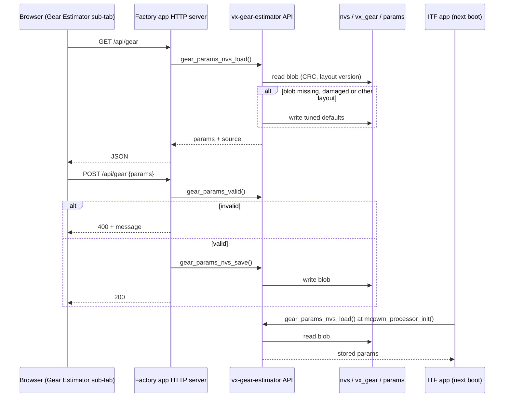
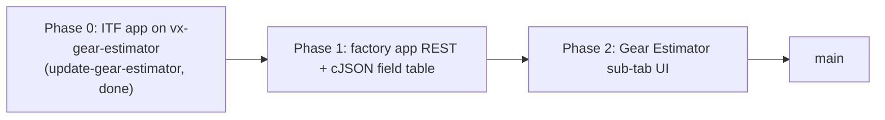

# Gear Estimator Parameters in the ITF Factory App (Proposal)

Status: decisions agreed, not implemented yet. Once implementation starts, this plan moves into `docs/IMPLEMENTATION_PLAN.MD`.

## Objective

Let the ITF factory app read, edit, validate and store the `gear_params_t` block used by the interface board's gear estimator, from a dedicated sub-tab of the web UI, so that a tuning can be changed on the car without rebuilding the ITF firmware.

## Agreed decisions

> [!NOTE]
> **Placement.** The editor lives inside Setup & Calibration, as a sub-tab or a section of that tab. No fifth top-level tab.

> [!NOTE]
> **Presets.** Only the tuned defaults (`gear_params_default_tuned()`) are offered. No F23 / F35 presets for now.

> [!NOTE]
> **No live preview.** The factory app does not run the estimator and the WebSocket telemetry frame is unchanged.

> [!NOTE]
> **Field/range table stays in the factory app.** The table of field names and ranges is kept in the ITF factory app only; `vx-gear-estimator` is not changed.

## What already makes this possible

> [!NOTE]
> **Shared storage.** The interface board now loads its parameters at boot with `gear_params_nvs_load()` from the [`vx-gear-estimator`](https://github.com/martinroger/vx-gear-estimator) component: one CRC-checked blob, namespace `vx_gear`, key `params`, in the default `nvs` partition. The factory app uses the same partition table ([`partitionTable.csv`](../factory%20apps/ITF%20factory%20app/partitionTable.csv) is identical to [`interface_board/partitionTable.csv`](../interface_board/partitionTable.csv)), so anything the factory app writes there with `gear_params_nvs_save()` is picked up by the ITF app on its next boot.

> [!NOTE]
> **No duplicated format.** The factory app should link the same component and only use its public API (`gear_params_nvs_load/save/erase`, `gear_params_valid`, `gear_params_default_tuned`). It must never write the blob by hand.

> [!WARNING]
> **Layout coupling.** The blob carries a layout version. If the two apps are built against component commits with a different `gear_params_t` layout, the ITF app discards the stored copy and rewrites the tuned defaults. Both apps must resolve the same component commit (same `dependencies.lock` entry), and later the same tag.

## UI structure

The Setup & Calibration tab gets a sub-tab bar. The existing cards move unchanged under "General".

```
[ ⚙️ Setup & Calibration ] [ ⚡ IO & Bus Debug ] [ 🚀 OTA & Partitions ] [ 💾 NVS Storage ]
   ├─ ( General )         odometer, trip, fuel and coolant cards (as today)
   └─ ( Gear Estimator )
        Source: NVS | tuned defaults (badge)
        ┌ Ratio model ───────────────┐ ┌ Gating ─────────────────────────────┐
        │ gear | ratio_mean | ratio_var │ │ min_speed_hz  (≈ km/h hint)         │
        │ 1..5 | number     | number    │ │ min_rpm_hz    (≈ RPM hint, ×30)     │
        └────────────────────────────┘ │ gate_mode     (select)              │
        ┌ Filter ────────────────────┐ └─────────────────────────────────────┘
        │ decay, inertia, p0,        │ ┌ Transitions (advanced, collapsed) ──┐
        │ conf_thresh, latch_ms      │ │ trans_* (6), accel_rpm_min_hz,       │
        └────────────────────────────┘ │ decel_speed_rate                    │
        ┌ Clutch drop (advanced) ────┐ └─────────────────────────────────────┘
        │ clutch_* (4)               │
        └────────────────────────────┘
        [Save to NVS] [Reload] [Load tuned defaults] [Erase stored copy]
```

- "Load tuned defaults" only fills the form; nothing is stored until Save.
- Save sends the whole block. The firmware validates it with `gear_params_valid()` and answers 400 with a message when it fails; the form keeps the user's values.
- "Erase stored copy" calls `gear_params_nvs_erase()`, so the next ITF boot falls back to the tuned defaults compiled into the ITF firmware.
- Field ranges shown in the form mirror `gear_params_valid()` (see the matrix below), plus the cross-field rule that `ratio_mean` must increase strictly from gear 1 to 5.

## Firmware changes (factory app)

1. **Dependency.** Add `vx-gear-estimator` (git, `version: main`, same as the interface board) to [`main/idf_component.yml`](../factory%20apps/ITF%20factory%20app/main/idf_component.yml) and to `REQUIRES` in [`main/CMakeLists.txt`](../factory%20apps/ITF%20factory%20app/main/CMakeLists.txt), plus `json` for cJSON. Commit the updated `dependencies.lock` and add the row to the README dependency matrix.
2. **REST endpoints** in [`main/main.cpp`](../factory%20apps/ITF%20factory%20app/main/main.cpp), registered next to `/api/settings`:

   | Method | URI | Body / reply |
   | :--- | :--- | :--- |
   | GET | `/api/gear` | `{"source":"nvs"\|"default"\|"default_unsaved","params":{...all fields...}}` from `gear_params_nvs_load()` |
   | GET | `/api/gear/defaults` | `{"params":{...}}` from `gear_params_default_tuned()`, nothing stored |
   | POST | `/api/gear` | `{"params":{...}}` → `gear_params_valid()` → `gear_params_nvs_save()`; 200, 400 (invalid) or 500 (NVS) |
   | POST | `/api/gear/erase` | `gear_params_nvs_erase()` |

   Use cJSON (`json` component, already in ESP-IDF) rather than the `find_param_val()` string scanning used by `/set_cal`: the block has 29 floats (two of them arrays) and an enum. Parse into a copy pre-filled from the current values, so a missing field keeps its stored value rather than becoming 0.
3. **Field table.** One static table `{name, offsetof(gear_params_t, field), min, max}` in the factory app drives both the JSON encoder and decoder, so adding a field is one line. Its ranges copy `gear_params_valid()`; the firmware still calls `gear_params_valid()` before saving, so a drift between the two can only make the form stricter or looser, never store an invalid block. The table stays in the factory app; the component is not changed.

## Parameter matrix (validation ranges from `gear_params_valid()`)

| Group | Field | Range | Unit / hint |
| :--- | :--- | :--- | :--- |
| Ratio model | `ratio_mean[1..5]` | 0.1 to 20, strictly increasing | speed Hz / RPM Hz |
| Ratio model | `ratio_var[1..5]` | 1e-5 to 10 | |
| Gating | `min_speed_hz` | 0 to 1000 | Hz, show km/h with `COEFF_FREQ_TO_SPEED_KPH_M` |
| Gating | `min_rpm_hz` | 0 to 1000 | Hz, show RPM (×30) |
| Gating | `gate_mode` | `NEUTRAL_ON_ANY` or `UNCERTAIN_ABOVE_SPEED_CUTOFF` | select |
| Filter | `decay` | 0.5 to 0.999 | |
| Filter | `inertia` | 0.3 to 0.999 | |
| Filter | `p0` | 1e-4 to 1 | |
| Filter | `conf_thresh` | 0.05 to 0.95 | |
| Filter | `latch_ms` | 0 to 2000 | ms |
| Transitions | `trans_neutral_stay`, `trans_neutral_exit`, `trans_floor`, `trans_shift_likely`, `trans_shift_blocked`, `trans_shift_neutral` | 0 to 1 | probability |
| Transitions | `accel_rpm_min_hz` | 0 to 1000 | Hz |
| Transitions | `decel_speed_rate` | -1000 to 0 | Hz/s |
| Clutch drop | `clutch_rpm_rate` | -1000 to 0 | Hz/s |
| Clutch drop | `clutch_speed_rate_min` | -1000 to 1000 | Hz/s |
| Clutch drop | `clutch_neutral_boost` | 1 to 100 | multiplier |
| Clutch drop | `clutch_density_floor` | 0 to 1 | multiplier |

## Sequence



## Phases



## Verification

- Control builds of both apps with ESP-IDF 5.5.5: `idf.py build` in `interface_board` and in `factory apps/ITF factory app`; check that both `dependencies.lock` files record the same `vx-gear-estimator` commit and no absolute path.
- Bench: flash the factory app, open the sub-tab, confirm the source badge reads "tuned defaults" on a blank NVS, then "NVS" after a save.
- Validation: POST a block with `ratio_mean` not increasing and with `decay` = 1.2; both must return 400 and leave the stored copy unchanged.
- Hand-over: change `latch_ms`, save, boot the ITF app, check the boot log `Gear parameters loaded from NVS` and the changed latch delay in the CAN gear signal.
- Erase: erase from the sub-tab, boot the ITF app, check it reports tuned defaults and rewrites the blob.
