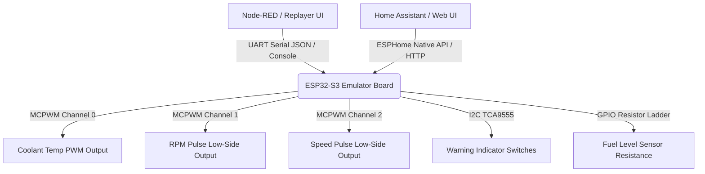

# Vehicle Emulator — Theory of Operation

## 1. Subsystem Architecture

The Emulator suite comprises firmware and orchestration layers for end-to-end bench validation:

---

## 2. Signal Simulation Mechanics

### 2.1 Hardware MCPWM Pulse Generation
- High-resolution MCPWM hardware timers generate precise frequencies without CPU jitter.
- Outputs are inverted at the ESP32-S3 GPIO Matrix (`GPIO_FUNC_OUT_INV_SEL`) to drive open-collector/low-side transistor switches.

### 2.2 19-Step Fuel Resistor Network
- Switched discrete resistor ladder replicates non-linear Opel Speedster / VX220 fuel sender curve in 19 steps from 30.2 $\Omega$ (level 1) to 270.0 $\Omega$ (level 19).
- Synchronized stepping logic ensures glitch-free transitions during bench drivecycle playback.

### 2.3 Low-Level Debug Frequency & Duty Cycle Controls
- **Speed Output**: Dedicated 1 Hz resolution frequency slider (0–1200 Hz) and 1% duty cycle slider (0–100%).
- **RPM Output**: Dedicated 1 Hz resolution frequency slider (0–400 Hz) and 1% duty cycle slider (0–100%).
- **Coolant Channel**: Dedicated 1% resolution duty cycle slider (0–100% at fixed 100 Hz).
- **Synchronous Bidirectional Telemetry**: Changes to physical gauges (`speed_kph`, `speed_mph`, `engine_rpm`, `coolant_temp`) synchronously update the debug sliders and telemetry sensors. Modulating debug sliders dynamically recalculates and publishes back the computed physical metrics to maintain coherent dashboard state.

---

## 3. Node-RED Drivecycle Replayer

The flow in [`node-red flow/flows.json`](node-red%20flow/flows.json) watches a folder of drivecycle files and replays the selected one to the emulator over the serial console. The folder comes from the `DRIVECYCLES_DIR` environment variable of the Node-RED process (for example `DRIVECYCLES_DIR=$HOME/Documents/drivecycles node-red`), so set it before starting Node-RED.
