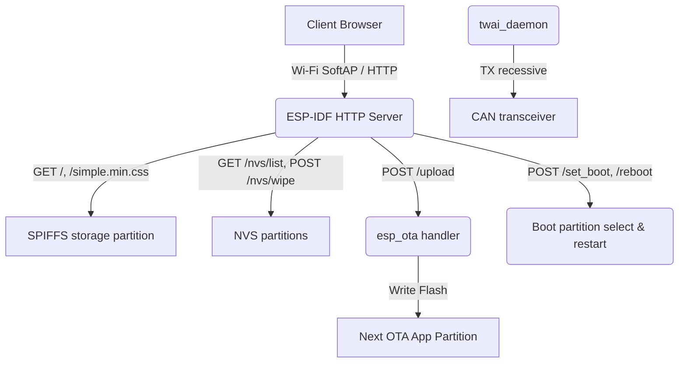

# LDB Factory App — Theory of Operation

## 1. Architecture Overview

The app has no display driver and no WebSocket endpoint. The LCD stays dark while it runs.

---

## 2. HTTP Endpoints

| Method | URI | Function |
| :--- | :--- | :--- |
| GET | `/`, `/simple.min.css` | Web page and stylesheet, served from the `storage` SPIFFS partition |
| GET | `/version` | Project name, version and build date from the app descriptor |
| GET | `/partitions` | Partition table and states |
| GET | `/prevboot` | Previously booted partition, from NVS `vx_sys`/`boot_slot` (falls back to the legacy `storage`/`lastPart`), and the partition to flash next |
| POST | `/upload` | Multipart upload of an app image into the next OTA partition |
| POST | `/set_boot` | Select the boot partition |
| POST | `/reboot` | Restart the MCU |
| GET | `/nvs/list` | All NVS partitions, namespaces and keys as JSON |
| POST | `/nvs/wipe` | Erase and re-initialize all NVS partitions |

---

## 3. Startup

- Mounts the `storage` SPIFFS partition.
- **TWAI / CAN Bus Protection**: Initializes `twai_daemon` with `initCAN(NULL)` on GPIO 19 (TX) and GPIO 20 (RX), holding the transceiver TX line recessive (logic HIGH) to prevent bus disruption while in factory app mode.
- Starts the SoftAP (`LDB-XXXXXX`), mDNS (`left-display.local`) and the HTTP server.
- **OTA Verification**: `/upload` validates the image with `esp_ota_end()` and only then sets it as the boot partition.
