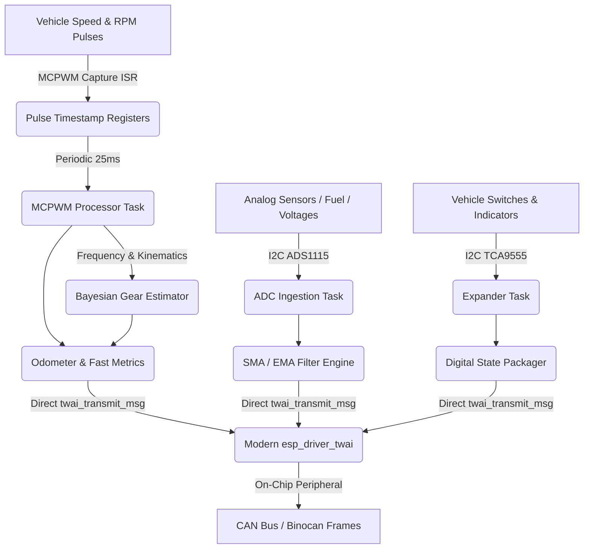
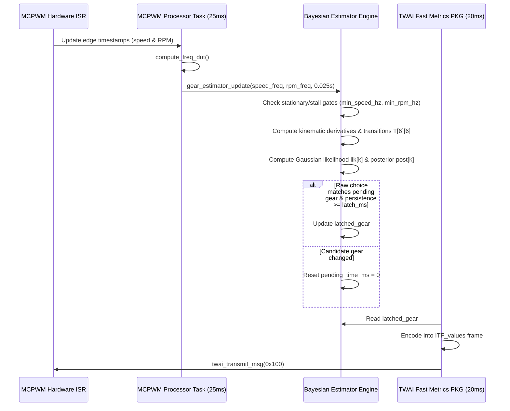

# Interface Board (ITF) — Theory of Operation

## 1. System Architecture

The Interface Board (ITF) is organized as a set of FreeRTOS tasks interacting with decoupled peripheral components:

---

## 2. Signal Processing & Ingestion

### 2.1 Speed & RPM Pulse Processing
- **Vehicle Speed**: Capture timer measures pulse period $\Delta t$. Speed in km/h is computed from pulses-per-km stored in NVS:
  $$v = \frac{3600}{\text{pulses\_per\_km} \times \Delta t}$$
- **Engine RPM**: Ignition pulse period is converted to revolutions per minute based on cylinder pulses per crankshaft revolution.
- **Pulse Accumulator**: Accumulated wheel pulses increment the high-resolution trip and odometer registers ([`odometer.c`](components/odometer/src/odometer.c)).
- **MCPWM Processor Task**: A deterministic 25 ms periodic task ([`mcpwm_processor.hpp`](main/mcpwm_processor.hpp)) computes duty cycles and frequencies for coolant, RPM, and wheel speed capture channels.

### 2.2 Analog Ingestion & Dual-Caliber Fuel Sensing
- ADS1115 samples analog channels continuously at configured data rates (Channel 0: Fuel sender, Channel 1: 12V rail, Channel 3: 3.3V reference $V_{dd}$).
- **Ratiometric Compensation**: Fuel sender resistance is computed against the live $V_{dd}$ reference reading on Channel 3 ($R_{load} = \text{COEFF\_FUEL\_CORRECTION\_MULT} \cdot K \cdot \text{raw}_{fuel} / \text{raw}_{3v3}$), with fallback to ideal 3.3V if measured $V_{ref} \notin [3.0\text{V}, 3.6\text{V}]$.
- **Dynamic Dual-Caliber Switching**:
  - Low caliber ($K_{lo} = 357.85$) switches to High caliber ($K_{hi} = 3673.88$) via GPIO 15 when $R > 300\,\Omega$.
  - High caliber switches back to Low caliber when $R < 275\,\Omega$.
  - Caliber switching evaluates instantaneous ADC counts to switch within <500 ms and synchronously re-samples and reseeds the filter.
- **Safety & Self-Learning**:
  - Open-circuit condition ($R > 3.4\text{ k}\Omega$) sets fuel level to 100% and latches the `lowFuel` telltale.
  - When `fuel_learn_en` is enabled in NVS, the board learns higher full-tank resistance values within a 10% SMA-averaged window ($\text{fuel\_full\_r} < R_{sma} \le 1.10 \times \text{fuel\_full\_r}$) and commits to NVS `fuel_full_r`.

### 2.3 Kinematic Bayesian Gear Position Estimation
The transmission gear position is estimated continuously by the kinematic-conditioned Bayesian classifier of the external [`vx-gear-estimator`](https://github.com/martinroger/vx-gear-estimator) component (`gear_estimator.h`), driven by the MCPWM processing loop in [`mcpwm_processor.hpp`](main/mcpwm_processor.hpp). The algorithm and every tunable field are described in that component's `docs/TOO.MD` and `docs/HOWTO.md`; this section only covers how the interface board uses it.

1. **Parameters**:
   At boot, `mcpwm_processor_init()` calls `gear_params_nvs_load()`, which reads one CRC-checked `gear_params_t` blob from the default NVS partition (namespace `vx_gear`). When the blob is missing, damaged or written by another `gear_params_t` layout, the tuned defaults compiled into the component (`gear_params_tuned.h`, generated by VX Bench) are used and written back. A stored copy wins over the compiled-in defaults, so a new tuning in the component only takes effect after the stored copy is erased or overwritten.

2. **Gear Ratio Model**:
   The ratio $r = f_{\text{speed}} / f_{\text{RPM}}$ is matched against one Gaussian per forward gear (`ratio_mean[5]`, `ratio_var[5]`).

3. **Kinematic Transitions & Clutch-Drop Suppression**:
   A 6-state transition matrix (Neutral, gears 1..5) favours upshifts when accelerating and downshifts when braking. A sudden RPM drop with sustained speed is treated as a clutch drop, and phantom upshifts are suppressed.

4. **Gating & Debounce**:
   Below the speed cutoff (`min_speed_hz`) the estimator reports `GEAR_NEUTRAL` (0). With the default gate mode, moving above that cutoff with RPM below `min_rpm_hz` reports `GEAR_UNCERTAIN` (14). A candidate gear must hold for `latch_ms` before `latched_gear` changes.

---

## 3. CAN Telemetry Dispatch

The TWAI daemon broadcasts frames via zero-copy direct transmission according to standard schedules:
- **`ITF_values` (20 ms)**: Real-time speed, RPM, and latched gear position (`itf_gear_position_st`).
- **`ITF_status` (50 ms)**: Coolant temperature, fuel level, battery voltage, and discrete indicators.
- **`ITF_odometer` (250 ms)**: Monotonic odometer and trip distance.
- **`ITF_board_version` (1000 ms)**: App descriptor metadata and git commit SHA.
- **`ITF_debug` (100 ms)**: Debug telemetry broadcast tasks (enabled conditionally via Kconfig):
  - `DBG_ITF_speed` (`0x300`): Raw speed frequency and duty cycle.
  - `DBG_ITF_RPM` (`0x301`): Raw RPM frequency and duty cycle.
  - `DBG_ITF_coolant` (`0x302`): Coolant sensor PWM frequency and duty cycle.
  - `DBG_ITF_ADC_raw` (`0x303`): Unfiltered supply rail voltages (3.3V $V_{dd}$ reference and 12V board rail).
  - `DBG_ITF_pulse_counts` (`0x304`): Cumulative monotonic pulse counts for RPM and vehicle speed signals.
  - `DBG_ITF_fuel` (`0x305`): Raw fuel sender voltage, unfiltered fuel percentage, active/learned $R_{full}$ baseline, and dynamic sender resistance ($\Omega$).
