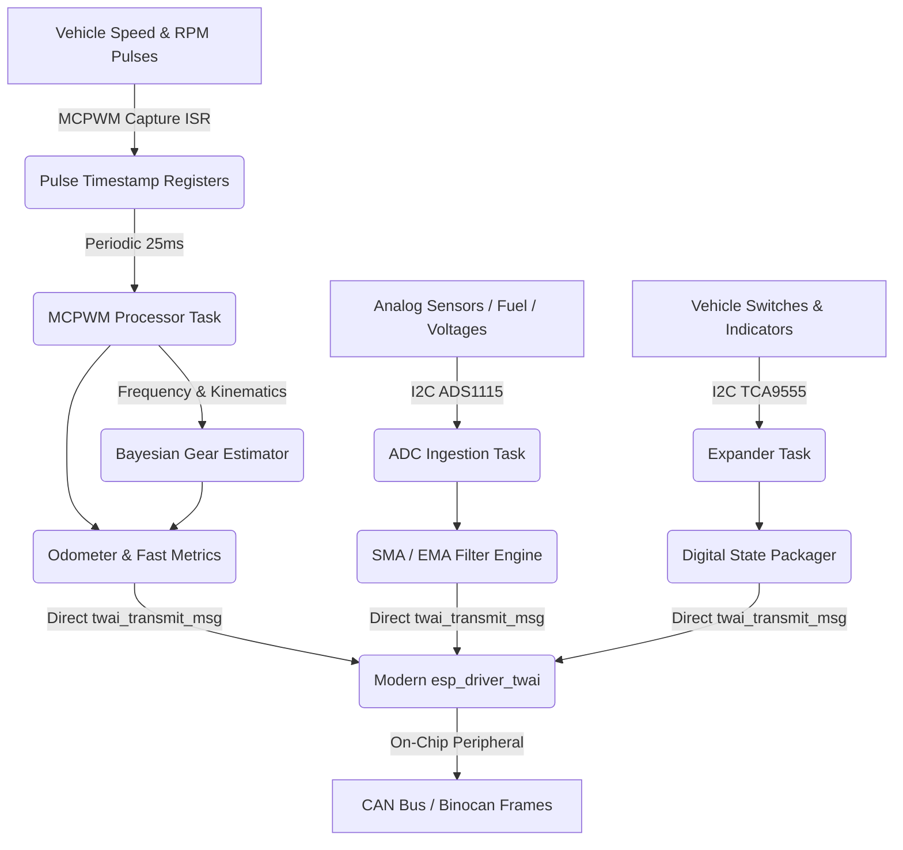
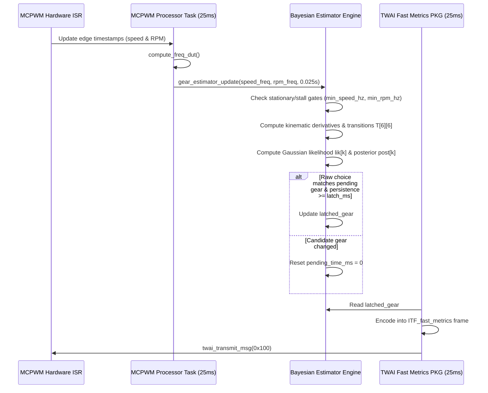

# Interface Board (ITF) — Theory of Operation

## 1. System Architecture

The Interface Board (ITF) is organized as a set of FreeRTOS tasks interacting with decoupled peripheral components:

---

## 2. Signal Processing & Ingestion

### 2.1 Speed & RPM Pulse Processing
- **Vehicle Speed**: The capture channel measures the speed pulse frequency $f$. Speed in km/h uses the fixed coefficient `COEFF_FREQ_TO_SPEED_KPH_M` from [`coefficients.h`](../common/coefficients.h) (no NVS key):
  $$v = \frac{7651}{31285} \cdot f$$
- **Engine RPM**: Ignition pulse period is converted to revolutions per minute based on cylinder pulses per crankshaft revolution.
- **Pulse Accumulator**: Accumulated wheel pulses increment the high-resolution trip and odometer registers ([`odometer.c`](components/odometer/src/odometer.c)).
- **MCPWM Processor Task**: A deterministic 25 ms periodic task ([`mcpwm_processor.hpp`](main/mcpwm_processor.hpp)) computes duty cycles and frequencies for coolant, RPM, and wheel speed capture channels.

### 2.1.1 ECE R39 Speed Compliance Mode
Optional, off by default. When `vx_r39`/`en` is set, `packItfFastMetrics()` broadcasts the speed from [`r39_compliance.hpp`](../common/r39_compliance.hpp) instead of the raw speed $v$:
  $$s = \min(v / v_b, 1), \quad w = s^2 (3 - 2s), \quad v_{out} = \mathrm{clamp}(A v + B w,\ 0,\ 400)$$
with $A = 1 + \texttt{r39\_a\_bp} / 10000$ (0 to +10 %), $B = \texttt{r39\_b\_ckph} / 100$ km/h (0 to 4 km/h) and $v_b$ = `CONFIG_R39_BLEND_END_KPH` (10 km/h). A stopped car reads 0 km/h, the curve is continuous and monotonic, and above $v_b$ it is exactly $A v + B$, so $0 \le v_{out} - v \le 0.1 v + 4$ km/h at every speed.
- Only `ITF_speed_kph` changes. `DBG_ITF_speed`, `DBG_ITF_pulse_counts`, the gear estimator, the odometer, the trip and the boot sweep keep the raw values.
- The three keys (`en`, `a_bp`, `b_ckph`) live in the `vx_r39` namespace of the default `nvs` partition and are edited from the ITF factory app. At boot a missing or out-of-range key is rewritten with its default (off, `400` = +4 %, `200` = 2 km/h).

### 2.2 Analog Ingestion & Dual-Caliber Fuel Sensing
- ADS1115 samples analog channels continuously at configured data rates (Channel 0: Fuel sender, Channel 1: 12V rail, Channel 3: 3.3V reference $V_{dd}$).
- **Ratiometric Compensation**: Fuel sender resistance is computed against the live $V_{dd}$ reference reading on Channel 3 ($R_{load} = \text{COEFF\_FUEL\_CORRECTION\_MULT} \cdot K \cdot \text{raw}_{fuel} / \text{raw}_{3v3}$), with fallback to ideal 3.3V if measured $V_{ref} \notin [3.0\text{V}, 3.6\text{V}]$.
- **Dynamic Dual-Caliber Switching**:
  - Low caliber ($K_{lo} = 357.85$) switches to High caliber ($K_{hi} = 3673.88$) via GPIO 15 when $R > 300\,\Omega$.
  - High caliber switches back to Low caliber when $R < 275\,\Omega$.
  - Caliber switching evaluates instantaneous ADC counts to switch within <500 ms and synchronously re-samples and reseeds the filter.
- **Safety & Self-Learning**:
  - Open-circuit condition ($R > 3.4\text{ k}\Omega$) sets fuel level to 100% and latches the `lowFuel` telltale.
  - When `vx_fuel`/`learn_en` is enabled in NVS, the board learns higher full-tank resistance values within a 10% SMA-averaged window ($R_{full} < R_{sma} \le 1.10 \times R_{full}$) and commits it to NVS `vx_fuel`/`full_ohm`.

### 2.3 Kinematic Bayesian Gear Position Estimation
The transmission gear position is estimated continuously by the kinematic-conditioned Bayesian classifier of the external [`vx-gear-estimator`](https://github.com/martinroger/vx-gear-estimator) component (`gear_estimator.h`), driven by the MCPWM processing loop in [`mcpwm_processor.hpp`](main/mcpwm_processor.hpp). The algorithm and every tunable field are described in that component's `docs/TOO.MD` and `docs/HOWTO.md`; this section only covers how the interface board uses it.

1. **Parameters**:
   At boot, `initMcpwmProcessor()` calls `gear_params_nvs_load()`, which reads one CRC-checked `gear_params_t` blob from the default NVS partition (namespace `vx_gear`). When the blob is missing, damaged or written by another `gear_params_t` layout, the tuned defaults compiled into the component (`gear_params_tuned.h`, generated by VX Bench) are used and written back. A stored copy wins over the compiled-in defaults, so a new tuning in the component only takes effect after the stored copy is erased or overwritten.

2. **Gear Ratio Model**:
   The ratio $r = f_{\text{speed}} / f_{\text{RPM}}$ is matched against one Gaussian per forward gear (`ratio_mean[5]`, `ratio_var[5]`).

3. **Kinematic Transitions & Clutch-Drop Suppression**:
   A 6-state transition matrix (Neutral, gears 1..5) favours upshifts when accelerating and downshifts when braking. A sudden RPM drop with sustained speed is treated as a clutch drop, and phantom upshifts are suppressed.

4. **Gating & Debounce**:
   Below the speed cutoff (`min_speed_hz`) the estimator reports `GEAR_NEUTRAL` (0). With the default gate mode, moving above that cutoff with RPM below `min_rpm_hz` reports `GEAR_UNCERTAIN` (14). A candidate gear must hold for `latch_ms` before `latched_gear` changes.

---

## 3. CAN Telemetry Dispatch

The TWAI daemon broadcasts frames via zero-copy direct transmission. IDs and cycle times come from `binocan` (`BINOCAN_*_FRAME_ID`, `BINOCAN_*_CYCLE_TIME_MS`):
- **`ITF_fast_metrics` (`0x100`, 25 ms)**: Real-time speed, RPM, and latched gear position (`itf_gear_position_st`).
- **`ITF_active_hi_lo` (`0x101`, 200 ms)**: Discrete telltales and switch states, including the coolant over-temperature telltale.
- **`ITF_slow_metrics` (`0x110`, 500 ms)**: Coolant temperature, fuel level and battery voltage.
- **`ITF_odometer` (`0x111`, 250 ms)**: Monotonic odometer and trip distance.
- **`ITF_board_st` (`0x120`, 200 ms)**: Board state machine, 5V rails, ADC and expander health, fuel sensing caliber, MCU temperature, and LDB/RDB alive flags.
- **`ITF_board_version` (`0x130`, 1000 ms)**: App descriptor metadata and git commit SHA.
- **Debug frames** (each enabled by its own Kconfig option):
  - `DBG_ITF_speed` (`0x300`, 25 ms): Raw speed frequency and duty cycle.
  - `DBG_ITF_RPM` (`0x301`, 25 ms): Raw RPM frequency and duty cycle.
  - `DBG_ITF_coolant` (`0x302`, 100 ms): Coolant sensor PWM frequency and duty cycle.
  - `DBG_ITF_ADC_raw` (`0x303`, 100 ms): Unfiltered supply rail voltages (3.3V $V_{dd}$ reference and 12V board rail).
  - `DBG_ITF_pulse_counts` (`0x304`, 100 ms): Cumulative monotonic pulse counts for RPM and vehicle speed signals.
  - `DBG_ITF_fuel` (`0x305`, 200 ms): Raw fuel sender voltage, unfiltered fuel percentage, active/learned $R_{full}$ baseline, and dynamic sender resistance ($\Omega$).

---

## 4. NVS Settings

All namespaces and keys are declared in [`common/nvs_keys.hpp`](../common/nvs_keys.hpp); the full table with types and defaults is in the [ITF factory app TOO](../factory%20apps/ITF%20factory%20app/TOO.MD#2-nvs-calibration-schema--provisioning-flow).

- **Default `nvs` partition**: `vx_fuel` (`learn_en`, `full_ohm`, `low_pct`), `vx_coolant` (`hot_degc`), `vx_r39` (`en`, `a_bp`, `b_ckph`) and `vx_gear` (gear estimator blob, owned by `vx-gear-estimator`). `loadCalibration()` reads them at boot with `vx::nvs::loadOrInit()`, which writes the default of a missing key (and of an out-of-range R39 key). A failure there calls `attemptRollback()`.
- **`nvs_odo` partition**: namespace `storage`, keys `odometer_m` and `trip_m`. These names are frozen.
- **Legacy names**: before the `vx_*` layout the settings sat in namespace `storage` of the default partition. `vx::nvs::migrateLegacyKeys()` runs before `loadCalibration()` and copies each old value to its new name when the new name is empty. Old entries are left in place for older images.
- **Boot slot**: holding the button and full-beam inputs low for 1 s at power-up (escape sequence) records the running slot in `vx_sys`/`boot_slot` (and in the legacy `storage`/`lastPart` for older factory apps) with `vx::nvs::recordBootSlot()`, so the factory app knows which slot to return to.
