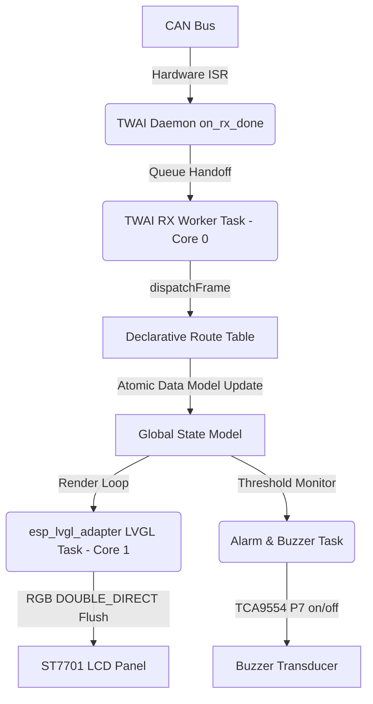

# Left Display Board (LDB) — Theory of Operation

## 1. Architecture Overview

The Left Display Board executes a multi-task FreeRTOS architecture:

---

## 2. UI Pipeline & Font Rendering

- **Display & LVGL**: Board bring-up (ST7701 RGB panel, GT911 touch, TCA9554 expander, LEDC backlight) in [`common/display_hw`](../common/display_hw/TOO.MD); LVGL task, lock and double-buffered DIRECT flush provided by `espressif/esp_lvgl_adapter`. The LVGL task core, priority and stack come from `menuconfig` → Display Application → LVGL task. The legacy `lvgl_port_lock()` / `lvgl_port_unlock()` names are kept by [`ui_lock.hpp`](main/ui_lock.hpp).
- **Typography**: Custom-generated White Rabbit pixel fonts (14 px to 128 px) for crisp contrast under automotive lighting.
- **Startup Animation**: The display has no animation code of its own. Once both displays report OK, the interface board (`sendAnimation()` in [`interface_board/main/main.cpp`](../interface_board/main/main.cpp)) ramps speed and RPM to full scale with all telltales on, holds, then resumes live telemetry; the display renders the frames it receives.
- **Gear Estimator Display Mode**: When `showGearPosition` is enabled in settings (toggled via [`action_enable_gears()`](main/main.cpp) and persisted in NVS key `"gear_on"`), the central gauge label switches from numeric RPM to the active transmission gear state decoded from `ITF_fast_metrics` ([`updateUI.hpp`](main/updateUI.hpp)):
  - `BINOCAN_ITF_FAST_METRICS_ITF_GEAR_POSITION_ST_NEUTRAL_CHOICE` (0) $\to$ `"N"`
  - `BINOCAN_ITF_FAST_METRICS_ITF_GEAR_POSITION_ST_UNCERTAIN_CHOICE` (14) $\to$ `"-"`
  - `BINOCAN_ITF_FAST_METRICS_ITF_GEAR_POSITION_ST_REVERSE_CHOICE` (15) $\to$ `"R"`
  - Forward Gears 1 to 5 $\to$ `"1"` .. `"5"`
  The perimeter RPM arc and shift light thresholds remain active and responsive to live engine speed.

---

## 3. CAN Telemetry & Declarative Route Dispatch

- **Declarative Routing Table**: Frame ingestion is orchestrated by `rx_routes[]` in [`twai_ops.hpp`](main/twai_ops.hpp), associating Frame IDs (`BINOCAN_ITF_ACTIVE_HI_LO_FRAME_ID`, `BINOCAN_ITF_SLOW_METRICS_FRAME_ID`, `BINOCAN_ITF_FAST_METRICS_FRAME_ID`, etc.) with unpack handlers and watchdog timers.
- **Watchdog Lifecycles**: Incoming frames automatically reset per-signal FreeRTOS software timers. If signal loss occurs (> 5 cycles), callbacks revert cluster variables to safe default failure values.
- **Overtemperature Alarm**: The threshold lives on the interface board (NVS `overtemp_th`, default 106 °C, no hysteresis), which sets `itf_over_temperature_tt` in `ITF_active_hi_lo`. The display mirrors that telltale: the over-temperature icon and coolant readout are highlighted, and if the buzzer setting is on, the buzzer stays on until the telltale clears.
