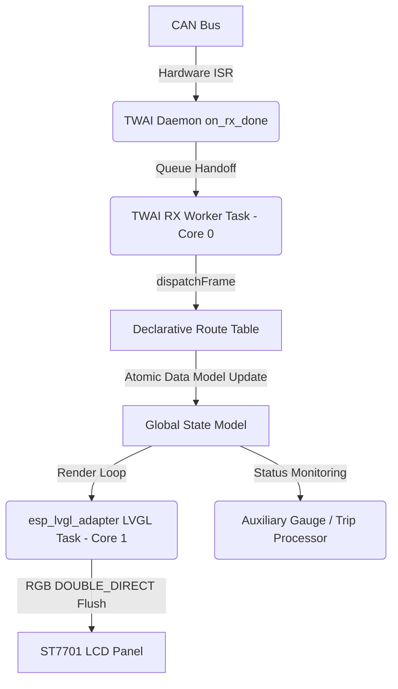

# Right Display Board (RDB) — Theory of Operation

## 1. Architecture Overview

The Right Display Board executes a multi-task FreeRTOS architecture:

---

## 2. UI Pipeline & Font Rendering

- **Display & LVGL**: Board bring-up (ST7701 RGB panel, GT911 touch, TCA9554 expander, LEDC backlight) in [`common/display_hw`](../common/display_hw/TOO.MD); LVGL task, lock and double-buffered DIRECT flush provided by `espressif/esp_lvgl_adapter`. The LVGL task core, priority and stack come from `menuconfig` → Display Application → LVGL task. The legacy `lvgl_port_lock()` / `lvgl_port_unlock()` names are kept by [`ui_lock.hpp`](main/ui_lock.hpp).
- **Typography**: Custom-generated White Rabbit pixel fonts (14 px to 128 px) for crisp contrast under automotive lighting.
- **Content**: Speed arc and readout (km/h or mph), fuel level, coolant, battery voltage, odometer and trip, telltales, and light/dark brightness settings. The external oil and charge-cooling frames are routed and watched, but no gauge shows them.
- **Startup Animation**: Driven by the interface board over CAN, as on the left display.

---

## 3. CAN Telemetry & Declarative Route Dispatch

- **Declarative Routing Table**: Frame ingestion is orchestrated by `rx_routes[]` in `twai_ops.hpp`, associating Frame IDs (`BINOCAN_ITF_ACTIVE_HI_LO_FRAME_ID`, `BINOCAN_ITF_SLOW_METRICS_FRAME_ID`, `BINOCAN_EXT_OIL_METRICS_FRAME_ID`, etc.) with unpack handlers and watchdog timers.
- **Watchdog Lifecycles**: Incoming frames automatically reset per-signal FreeRTOS software timers. If signal loss occurs (> 5 cycles), callbacks revert cluster variables to safe default failure values.

---

## 4. NVS Settings

Namespace `vx_disp` in the default `nvs` partition, declared in [`common/nvs_keys.hpp`](../common/nvs_keys.hpp). The settings screen writes a key when it changes. At boot each key is read into `displayBoard`; a missing key keeps the compiled-in default from [`global_vars.hpp`](main/global_vars.hpp) and is not written.

| Key | Type | Default | Description |
| :--- | :--- | :--- | :--- |
| `unit_mph` | `u8` | `0` | `1` shows mph, `0` km/h |
| `gear_show` | `u8` | `0` | `1` shows the gear position instead of the RPM |
| `alarm_ovr` | `u8` | `0` | `1` when the vehicle overrides the RPM alarm |
| `alarm_rpm` | `u32` | `6000` | RPM alarm threshold (rpm) |
| `alarm_blink` | `u8` | `0` | `1` when the RPM alarm blinks |
| `shift_en` | `u8` | `0` | `1` when the shift indicator is on |
| `shift_mid_rpm` | `u32` | `5500` | Orange shift threshold (rpm) |
| `shift_top_rpm` | `u32` | `6500` | Red shift threshold (rpm) |
| `rpm_decim` | `u32` | `10` | RPM display decimation factor |
| `hot_buzz_en` | `u8` | `0` | `1` turns the buzzer on with the overtemperature telltale |
| `bl_dark_pct` | `u8` | `100` | Backlight in the dark theme (%) |
| `bl_light_pct` | `u8` | `100` | Backlight in the light theme (%) |
| `theme_locked` | `u8` | `0` | `1` locks the theme against automatic light/dark switching |
| `theme_light` | `u8` | `1` | `1` when the light theme is active; read at boot only when the theme is locked |

- **Legacy names**: before the `vx_*` layout these keys sat in namespace `storage` (`mph_on`, `gear_on`, `rpm_al_overr`, `rpm_al_thr`, `rpm_al_blnk`, `shft_ind`, `shft_mid`, `shft_top`, `rpm_dec`, `overt_bzz`, `dark_bg`, `light_bg`, `th_locked`, `light_th`). `vx::nvs::migrateLegacyKeys()` copies each one to its new name at boot when the new name is empty, and leaves the old entry in place.
- **Boot slot**: every boot records the running slot in `vx_sys`/`boot_slot` (and the legacy `storage`/`lastPart`) with `vx::nvs::recordBootSlot()`; the display factory app reads it for `/prevboot`.
